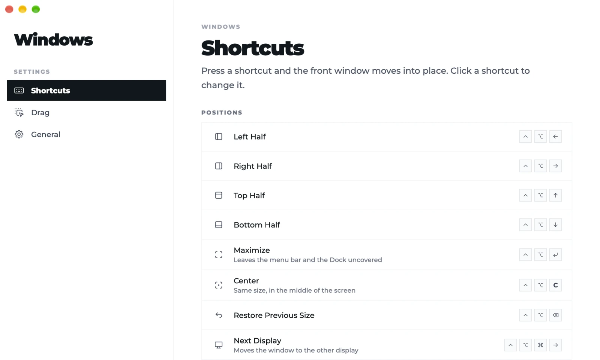
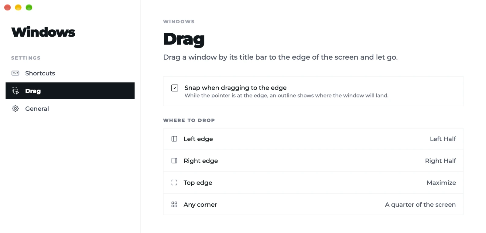

# Windows by Ciro Cesar Maciel

**A small, open window manager for the Mac: snap windows by shortcut or by dragging them to the edge.**

One of [six free, open-source Mac apps](#more-from-ciro-cesar-maciel) by [Ciro Cesar Maciel](https://ciromaciel.click/?ref=oss-windows).

Halves, full screen, center, the next display and sizes of your own, each on a shortcut you can change. Drag a window to an edge or a corner and let go. It lives in the menu bar, with no Dock icon, and it has no network code. In the spirit of Rectangle and Magnet, deliberately smaller. A native Swift app for macOS 14+ on Apple Silicon.

[Português](README.pt-BR.md)



## Install

```bash
curl -fsSL https://blob.ciromaciel.click/tools/windows/install.sh | bash
```

The script downloads the latest `.dmg`, copies Windows to `/Applications` and opens it.

Prefer the disk image? [Download Windows-macos.dmg](https://blob.ciromaciel.click/tools/windows/latest/Windows-macos.dmg). Open it and drag Windows to Applications. It is signed with Developer ID and notarized by Apple, so macOS opens it with no warning.

On the first run, turn on Windows in **System Settings → Privacy & Security → Accessibility**. That is the permission macOS requires for an app to move other apps' windows; Windows shows the system prompt, opens its settings, and notices by itself when the permission is on.

## What it does

| Default shortcut | Where the front window goes |
| --- | --- |
| ⌃⌥← / ⌃⌥→ | Left / right half |
| ⌃⌥↑ / ⌃⌥↓ | Top / bottom half |
| ⌃⌥↩ | Full screen, without covering the menu bar and the Dock |
| ⌃⌥C | Center, same size |
| ⌃⌥⌫ | Back to the size and place it had before |
| ⌃⌥⌘→ | Next display, same relative place and size |
| ⌥F / ⌥D / ⌥S | The three sizes that ship: 97.1% × 97% centered, 80% at the top, 60% at the top |

- **Every shortcut is yours.** In Settings, click a shortcut and press the new combination; ⌫ removes it, Esc cancels. "Restore default shortcuts" undoes it all.
- **Your own sizes.** Name, width and height (a share of the screen or points), a place on a 3 × 3 grid, which display (the window's, the main one, the next one) and a shortcut, with a live preview. Deleting one is a 3-second hold.
- **Drag to the edge.** Left or right edge, half; top edge, full screen; a corner, a quarter. While the cursor is in a zone, an outline shows where the window will land. It snaps only when the window moved and kept its size, so resizing or selecting text never triggers it. It can be turned off.
- **Conflict check.** When you record a shortcut, Windows looks for who else uses it: the macOS shortcuts that are on, the menus of every open app (through Accessibility), another window manager that is running, and its own table. A repeat inside Windows is refused; the others are shown in red. A global shortcut of another app is invisible to macOS's public APIs, and the settings say so.
- **Shares the Mac with other window managers.** It recognizes a running Rectangle, Rectangle Pro, Magnet, Moom and a few others, warns in the menu and in Settings, and takes the shortcuts back as soon as the other one quits.
- **Menu bar only.** Every position and size is one click away in the menu, and it can open when you log in.



## How it is built

- Swift, AppKit (menu bar, native menu) and SwiftUI (Settings), compiled by `swiftc`: no Xcode project, no package manager, no dependencies.
- Shortcuts with Carbon's `RegisterEventHotKey`. Moving a window goes through the Accessibility API: size, position, size again, with `AXEnhancedUserInterface` turned off during the move.
- Dragging uses global mouse monitors.
- No network code: no `URLSession`, no sockets. Your shortcuts and sizes are saved in the app's user defaults on this Mac.

## Build it yourself

You need the Xcode Command Line Tools. Xcode itself is optional.

```bash
git clone https://github.com/ciro-maciel/windows.git
cd windows
scripts/build.sh                 # dist/Windows.app
open dist/Windows.app
```

`scripts/build.sh` signs with a Developer ID Application certificate when your keychain has one (the official build does), with the hardened runtime. Otherwise run `scripts/signing-identity.sh` once: it creates a local signing certificate, and with it the Accessibility permission survives each rebuild. Without either, the build is signed ad hoc and macOS asks again every time.

Tests:

```bash
dist/Windows.app/Contents/MacOS/Windows --selftest          # geometry, sizes, drag zones and shortcuts; moves no window
dist/Windows.app/Contents/MacOS/Windows --conflicts cmd+n   # who else uses a combination
scripts/e2e.sh                                              # end to end: real key presses, mouse drags and the menu
```

`scripts/e2e.sh` opens its own window and uses a separate settings suite, so your settings are never touched. It takes over the mouse and keyboard for about 40 seconds, closes a running Rectangle, Rectangle Pro or Windows for the test and reopens it at the end, and needs Accessibility for the terminal that runs it.

## Limits

- Apple Silicon and macOS 14 or newer only.
- The interface is in English and Brazilian Portuguese, following the Mac's language.
- Left out on purpose: thirds and size cycling, gaps between windows, saved layouts, trackpad gestures and iCloud sync.

## Contributing

Issues and pull requests are welcome. See [CONTRIBUTING.md](CONTRIBUTING.md).

## License

[MIT](LICENSE). Fonts and icons keep their own licenses: see [NOTICE](NOTICE). Rectangle, Magnet and the other apps named here are products of their own makers; this project is not affiliated with them.

---

## More from Ciro Cesar Maciel

I build software on my own, with a team of AI agents, and open what I can. Six native Mac apps, all free, MIT, signed and notarized by Apple, in English and Brazilian Portuguese: [Cleaner](https://github.com/ciro-maciel/cleaner), the Mac cleaner that shows you everything before it deletes anything · [Screenshots](https://github.com/ciro-maciel/screenshots), capture, annotate and record the screen, with nothing leaving your Mac · [Speech to Text](https://github.com/ciro-maciel/speech-to-text), dictation by shortcut, with Whisper running on your Mac · [Assistant](https://github.com/ciro-maciel/voice-assistant), Claude Code by voice · [Windows](https://github.com/ciro-maciel/windows), snap windows into place with a shortcut or by dragging them to the edge (this one) · [Text to Speech](https://github.com/ciro-maciel/text-to-speech), select text in any app and hear it read aloud.

Beyond the apps: [free tools for the browser](https://ciromaciel.click/tools?ref=oss-windows), [books](https://ciromaciel.click/books?ref=oss-windows), and [Infrastructure](https://myinfrastructure.click/?ref=oss-windows), the infrastructure AI agents already know how to run.

**Follow along.** [Follow @ciro-maciel](https://github.com/ciro-maciel) for the next open-source apps, click **Watch → Custom → Releases** above for every new version, and see how it is all made on [YouTube](https://www.youtube.com/@ciro-maciel) and at [ciromaciel.click](https://ciromaciel.click/?ref=oss-windows).
