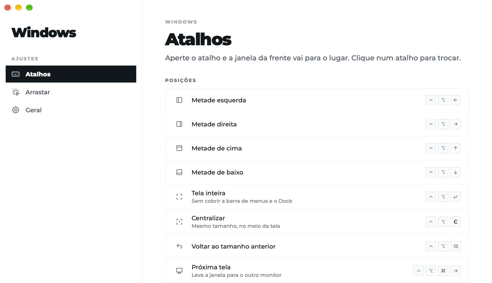
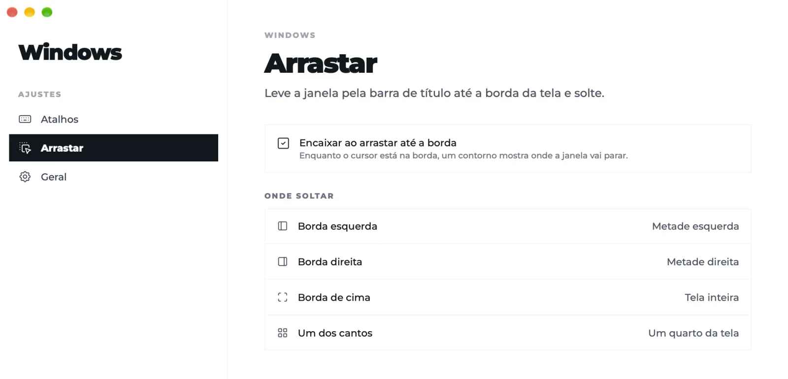

# Windows by Ciro Cesar Maciel

**Um gerenciador de janelas pequeno e aberto para o Mac: encaixe as janelas por atalho ou arrastando até a borda.**

Um dos [seis apps de Mac grátis e de código aberto](#mais-de-ciro-cesar-maciel) de [Ciro Cesar Maciel](https://ciromaciel.click/?ref=oss-windows).

**[Veja o vídeo de 1 minuto](https://youtu.be/CbZBvyRRED4)** (em inglês)

Metades, tela inteira, centralizar, a próxima tela e tamanhos seus, cada um num atalho que você pode trocar. Leve uma janela até uma borda ou um canto e solte. Fica na barra de menus, sem ícone no Dock, e não tem código de rede. No espírito do Rectangle e do Magnet, menor de propósito. Um app nativo em Swift para macOS 14+ em Apple Silicon.

[English](README.md)



## Instalar

```bash
curl -fsSL https://blob.ciromaciel.click/tools/windows/install.sh | bash
```

O script baixa o `.dmg` mais recente, copia o Windows para `/Applications` e abre o app.

Prefere a imagem de disco? [Baixe o Windows-macos.dmg](https://blob.ciromaciel.click/tools/windows/latest/Windows-macos.dmg). Abra e arraste o Windows para Aplicativos. Ele é assinado com Developer ID e notarizado pela Apple, então o macOS abre sem aviso.

Na primeira vez, ligue o Windows em **Ajustes do Sistema → Privacidade e Segurança → Acessibilidade**. É a permissão que o macOS exige para um app mover janelas de outros apps; o Windows mostra o pedido do sistema, abre os Ajustes dele e percebe sozinho quando a permissão foi ligada.

## O que faz

| Atalho de fábrica | Para onde vai a janela da frente |
| --- | --- |
| ⌃⌥← / ⌃⌥→ | Metade esquerda / direita |
| ⌃⌥↑ / ⌃⌥↓ | Metade de cima / de baixo |
| ⌃⌥↩ | Tela inteira, sem cobrir a barra de menus e o Dock |
| ⌃⌥C | Centralizar, no mesmo tamanho |
| ⌃⌥⌫ | Voltar ao tamanho e ao lugar de antes |
| ⌃⌥⌘→ | Próxima tela, no mesmo lugar e tamanho relativos |
| ⌥F / ⌥D / ⌥S | Os três tamanhos que vêm prontos: 97,1% × 97% no centro, 80% em cima, 60% em cima |

- **Todo atalho é seu.** Em Ajustes, clique num atalho e aperte a combinação nova; ⌫ tira o atalho, esc cancela. "Voltar aos atalhos padrão" desfaz tudo.
- **Tamanhos seus.** Nome, largura e altura (em parte da tela ou em pontos), uma posição numa grade 3 × 3, em qual tela (a da janela, a principal, a próxima) e atalho, com prévia ao vivo. Excluir é segurar o botão por 3 segundos.
- **Arrastar até a borda.** Borda esquerda ou direita, metade; borda de cima, tela inteira; um canto, um quarto. Enquanto o cursor está numa zona, um contorno mostra onde a janela vai parar. Só encaixa quando a janela mudou de lugar e manteve o tamanho, então redimensionar ou selecionar texto nunca dispara. Dá para desligar.
- **Confere conflitos.** Ao gravar um atalho, o Windows procura quem mais usa a combinação: os atalhos do macOS que estão ligados, os menus de todos os apps abertos (pela Acessibilidade), outro gerenciador de janelas aberto e a própria tabela. Repetido dentro do Windows é recusado; os outros aparecem em vermelho. Atalho global de outro app é invisível para as APIs públicas do macOS, e os Ajustes dizem isso.
- **Divide o Mac com outros gerenciadores de janelas.** Reconhece Rectangle, Rectangle Pro, Magnet, Moom e alguns outros abertos, avisa no menu e nos Ajustes, e retoma os atalhos assim que o outro fecha.
- **Só na barra de menus.** Todas as posições e tamanhos ficam a um clique no menu, e ele pode abrir quando você liga o Mac.



## Como é feito

- Swift, AppKit (barra de menus, menu nativo) e SwiftUI (Ajustes), compilado pelo `swiftc`: sem projeto do Xcode, sem gerenciador de pacotes, sem dependências.
- Atalhos com o `RegisterEventHotKey` do Carbon. Mover uma janela passa pela API de Acessibilidade: tamanho, posição, tamanho de novo, com o `AXEnhancedUserInterface` desligado durante o movimento.
- Arrastar usa monitores globais de mouse.
- Sem código de rede: nenhum `URLSession`, nenhum socket. Seus atalhos e tamanhos ficam nos ajustes do app neste Mac.

## Compilar você mesmo

Precisa das Command Line Tools do Xcode. O Xcode em si é opcional.

```bash
git clone https://github.com/ciro-maciel/windows.git
cd windows
scripts/build.sh                 # dist/Windows.app
open dist/Windows.app
```

O `scripts/build.sh` assina com um certificado Developer ID Application quando o seu chaveiro tem um (o build oficial tem), com o hardened runtime. Senão, rode `scripts/signing-identity.sh` uma vez: ele cria um certificado de assinatura local, e com ele a permissão de Acessibilidade sobrevive a cada novo build. Sem nenhum dos dois, o build é assinado ad hoc e o macOS pede de novo toda vez.

Testes:

```bash
dist/Windows.app/Contents/MacOS/Windows --selftest          # geometria, tamanhos, zonas de arrasto e atalhos; não move janela
dist/Windows.app/Contents/MacOS/Windows --conflicts cmd+n   # quem mais usa uma combinação
scripts/e2e.sh                                              # ponta a ponta: teclas de verdade, arrastos de mouse e o menu
```

O `scripts/e2e.sh` abre uma janela própria e usa um conjunto de ajustes separado, então os seus nunca mudam. Ele toma o mouse e o teclado por uns 40 segundos, fecha um Rectangle, Rectangle Pro ou Windows aberto durante o teste e reabre no fim, e precisa de Acessibilidade para o terminal que o roda.

## Limites

- Só Apple Silicon e macOS 14 ou mais novo.
- A interface está em inglês e em português do Brasil, conforme o idioma do Mac.
- Fica de fora de propósito: terços e ciclos de tamanho, espaço entre janelas, layouts salvos, gestos do trackpad e sincronização pelo iCloud.

## Contribuir

Issues e pull requests são bem-vindos. Veja o [CONTRIBUTING.md](CONTRIBUTING.md).

## Licença

[MIT](LICENSE). Fontes e ícones mantêm as próprias licenças: veja o [NOTICE](NOTICE). Rectangle, Magnet e os outros apps citados aqui são produtos dos próprios autores; este projeto não tem vínculo com eles.

---

## Mais de Ciro Cesar Maciel

Eu construo software sozinho, com uma equipe de agentes de IA, e abro o que dá para abrir. Seis apps nativos para Mac, todos grátis, MIT, assinados e notarizados pela Apple, em inglês e português do Brasil: [Cleaner](https://github.com/ciro-maciel/cleaner), o limpador de Mac que mostra tudo antes de apagar qualquer coisa · [Screenshots](https://github.com/ciro-maciel/screenshots), captura, anotação e gravação de tela, sem nada sair do Mac · [Speech to Text](https://github.com/ciro-maciel/speech-to-text), ditado por atalho, com o Whisper rodando no Mac · [Assistant](https://github.com/ciro-maciel/voice-assistant), o Claude Code por voz · [Windows](https://github.com/ciro-maciel/windows), janelas no lugar com um atalho ou levando até a borda (este) · [Text to Speech](https://github.com/ciro-maciel/text-to-speech), selecione um texto em qualquer app e ouça.

Além dos apps: [ferramentas grátis no navegador](https://ciromaciel.click/tools?ref=oss-windows), [livros](https://ciromaciel.click/books?ref=oss-windows) e o [Infrastructure](https://myinfrastructure.click/?ref=oss-windows), a infraestrutura que os agentes já sabem operar.

**Toda semana, por e-mail:** as [Cartas do Ciro](https://ciromaciel.click/?ref=oss-windows), o que estou construindo e aprendendo.

**Acompanhe.** [Siga @ciro-maciel](https://github.com/ciro-maciel) para os próximos apps abertos, clique em **Watch → Custom → Releases** aqui em cima para saber de cada versão nova, e veja como tudo é feito no [YouTube](https://www.youtube.com/@ciro-maciel).
